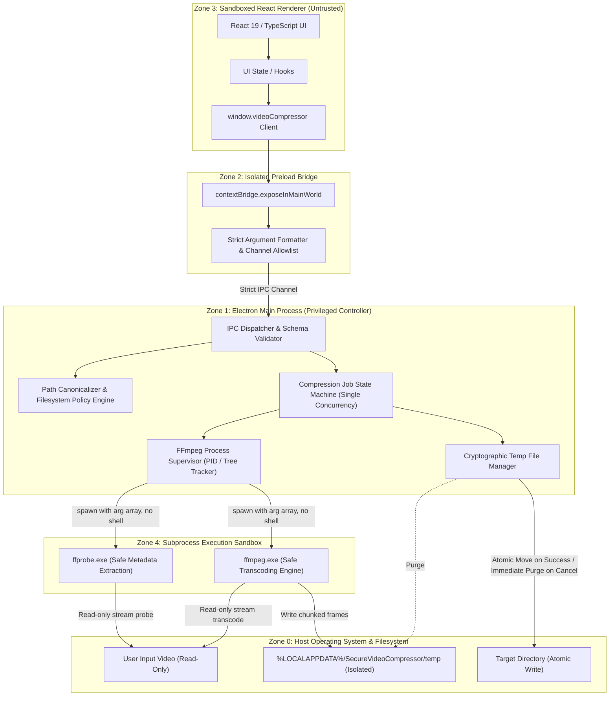
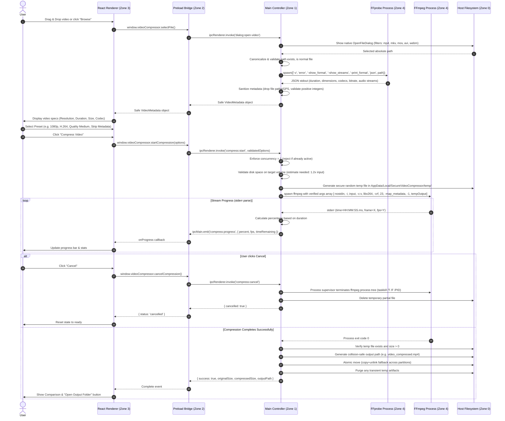

# PHASE 1: Architecture, Threat Model, and Security Specifications

**Application:** Secure Video Compressor  
**Target Platform:** Windows (x64 / arm64)  
**Security Classification:** Privacy-First, Zero-Telemetry, Offline-First Desktop Utility  
**Date:** November 2026  
**Architect:** Principal Desktop Security Architect & Privacy Engineer  

---

## 1. Executive Summary & Design Principles

The **Secure Video Compressor** is engineered to compress video media locally on the user's host machine with zero cloud connectivity, zero telemetry, zero crash reporting, and zero external network requests. 

### Core Security & Privacy Principles:
1. **Least Privilege by Default:** The renderer process runs in an isolated, sandboxed Chromium container with no direct access to Node.js APIs, the operating system, network, or filesystem.
2. **Strict Trust Boundaries:** All IPC messages originating from the Renderer are treated as untrusted network packets. Every parameter is strictly typed, schema-validated, range-bounded, and path-canonicalized before reaching privileged operating system primitives.
3. **No Shell Execution:** Under no circumstances is `child_process.exec`, `cmd.exe`, or `powershell.exe` invoked. FFmpeg and FFprobe are executed exclusively via `child_process.spawnFile` / `spawn` with discrete, non-concatenated argument arrays.
4. **Data Minimization & Metadata Sanitization:** By default, output containers strip all non-essential private streams and metadata (GPS tags, camera serial numbers, creation timestamps, author metadata, encoder comments).
5. **Fail-Safe & Atomic File Operations:** Outputs are written to a private application temp staging location and verified before atomic rename/move. Failures trigger immediate process tree termination and deterministic temp file purge.
6. **Air-Gapped Operation:** The Content Security Policy (CSP), Chromium web preferences, and Electron session handlers strictly deny remote resource loading, outbound HTTP/WebSocket requests, and navigation.

---

## 2. Trust Boundaries & Architecture Diagram

### 2.1 Trust Zones
- **Zone 0: Operating System & Host Environment:** Kernel, NTFS filesystem, Windows process manager.
- **Zone 1: Electron Main Process (Privileged Host Node.js context):** Holds OS-level privileges restricted to user-designated targets; manages lifecycle, IPC validation, window creation, temp directory sandbox, and worker process spawning.
- **Zone 2: Preload Script Bridge (Context-Isolated Boundary):** Exposes an immutable, minimal, strongly typed API via `contextBridge.exposeInMainWorld`. No raw Electron or Node objects leak through.
- **Zone 3: React Renderer Process (Untrusted Chromium Sandbox):** UI presentation layer. Sandboxed, no Node integration, no filesystem access, restricted CSP (`default-src 'self'`).
- **Zone 4: FFmpeg/FFprobe Subprocess (Constrained Worker):** Isolated child processes executed with minimal environment variables, restricted working directory, standard handle redirection, and explicit lifecycle control.

### 2.2 Architecture Diagram



---

## 3. Data Flow Diagram



---

## 4. Threat Model & Abuse Case Matrix

Following the STRIDE and custom desktop application threat taxonomy:

| ID | Threat Category | Threat Description | Attacker Objective | Defensive Mitigation |
|---|---|---|---|---|
| **T1** | **Spoofing / IPC Injection** | Malicious renderer or XSS payload invokes internal IPC channels with manipulated payloads or invokes non-existent channels. | Bypass UI restrictions, invoke raw OS commands, or crash application. | 1. Channel allowlist in Main.<br>2. Complete input schema validation (type, enum, range checks) on every IPC handler.<br>3. Reject IPC handlers returning handles or raw process references. |
| **T2** | **Tampering / Command Injection** | Filename or user input contains shell metacharacters: `video.mp4; calc.exe`, `video$(rmdir /s /q C:)`, `& dir`, quotes, pipes. | Remote or local code execution via command-line interpreter. | 1. **Never use `exec()` or `shell: true`.**<br>2. Always use `child_process.spawn()` with exact arguments array.<br>3. Validate that paths are well-formed Windows absolute paths without null bytes or control characters. |
| **T3** | **Information Disclosure / Path Traversal** | Renderer passes relative path `../../../../Windows/System32/config/SAM` or UNC path `\\attacker.com\share`. | Exfiltrate or read unauthorized host files, or trigger NTLM hash leakage via SMB. | 1. Canonicalize via `path.resolve` and `fs.realpath`.<br>2. Block UNC paths (`\\?\UNC\`, `\\hostname\`).<br>3. Verify file exists, is regular file (not directory, not pipe, not device file).<br>4. Block access to Windows system root / program files. |
| **T4** | **Renderer Compromise / Privilege Escalation** | Vulnerability in React dependency or Chromium allows RCE in Renderer. | Compromise the underlying operating system. | 1. `contextIsolation: true`.<br>2. `nodeIntegration: false`.<br>3. `sandbox: true`.<br>4. `webSecurity: true`.<br>5. `allowRunningInsecureContent: false`.<br>6. Strict CSP: `default-src 'self'; script-src 'self'; style-src 'self' 'unsafe-inline'; img-src 'self' data:; connect-src 'none'; font-src 'self'`.<br>7. Block `will-navigate` and `new-window` / `setWindowOpenHandler`. |
| **T5** | **Supply Chain & Malicious Dependencies** | Vulnerable npm package containing telemetry, miners, or phone-home backdoors. | Exfiltrate video metadata or compromise host. | 1. Ultra-minimal dependencies (Electron, React, React-DOM, TypeScript, Vite).<br>2. Zero analytics/logging packages.<br>3. Strict package lockfile.<br>4. CSP `connect-src 'none'` blocks any browser-side network call even if injected. |
| **T6** | **Privacy Leakage via Metadata & Logs** | User video contains GPS coordinates, home address, device serial numbers, or sensitive filenames logged to disk or console. | Unintended user privacy leakage to disk or third-party log collectors. | 1. Default to stripping all metadata (`-map_metadata -1`).<br>2. Privacy-safe logger: redact usernames, user home paths, and personal filenames (`C:\Users\<REDACTED>\Videos\<FILE>`).<br>3. Absolutely zero network transmission. |
| **T7** | **Temporary File Leakage & Predictable Names** | Transcoded intermediate video left behind in insecure `%TEMP%` readable by other low-integrity local users. | Information disclosure of confidential video frames. | 1. Dedicated app-owned temp directory in `%LOCALAPPDATA%\SecureVideoCompressor\temp` with restricted DACLs.<br>2. Cryptographically secure random filenames (`crypto.randomBytes(16).toString('hex')`).<br>3. Lifecycle hooks: on clean exit, cancellation, and startup crash recovery, scrub orphaned temp files. |
| **T8** | **Denial of Service / Resource Exhaustion** | 100GB video or zip-bomb / malformed video causes CPU freeze, disk saturation, or multiple spawned FFmpeg instances. | Host instability, drive full crash. | 1. Strict single-job concurrency (`activeJob !== null`).<br>2. Pre-flight disk space verification before transcode starts.<br>3. Graceful job termination with tree-kill on cancel.<br>4. FFmpeg runs at normal/below-normal process priority. |
| **T9** | **Malicious Codec / FFmpeg Exploit Payload** | Specially crafted container targeting known FFmpeg demuxer vulnerabilities. | Memory corruption in worker process. | 1. Use vetted, stable FFmpeg build.<br>2. FFmpeg runs as unprivileged child process without administrative privileges.<br>3. Subprocess IO is piped; standard input is closed (`-nostdin`). |

---

## 5. Security Decisions & Specifications

### 5.1 Electron Hardening Configuration
```typescript
const mainWindow = new BrowserWindow({
  width: 960,
  height: 720,
  minWidth: 800,
  minHeight: 600,
  center: true,
  show: false,
  webPreferences: {
    contextIsolation: true,
    nodeIntegration: false,
    nodeIntegrationInWorker: false,
    nodeIntegrationInSubFrames: false,
    sandbox: true,
    webSecurity: true,
    allowRunningInsecureContent: false,
    navigateOnDragDrop: false,
    preload: path.join(__dirname, '../preload/index.js'),
    devTools: process.env.NODE_ENV === 'development'
  }
});
```
- Navigation Prevention:
  ```typescript
  mainWindow.webContents.on('will-navigate', (event) => event.preventDefault());
  mainWindow.webContents.setWindowOpenHandler(() => ({ action: 'deny' }));
  ```
- Session CSP header injection:
  ```http
  default-src 'self'; script-src 'self'; style-src 'self' 'unsafe-inline'; img-src 'self' data:; connect-src 'none'; font-src 'self'; media-src 'self' blob:; object-src 'none'; base-uri 'none'; form-action 'none'; frame-ancestors 'none';
  ```

### 5.2 FFmpeg Sourcing & Verification Strategy
- **Bundled Binaries:** `ffmpeg.exe` and `ffprobe.exe` are placed in the application's secure native resources directory:
  - In Development: `<projectRoot>/resources/bin/win32-x64/`
  - In Production: `process.resourcesPath/bin/`
- **Verification on Startup:**
  - Verify that the binary path resolves strictly inside the application directory.
  - Calculate SHA-256 hash at startup and compare against hardcoded cryptographic checksum manifest (`binaries.manifest.json`).
  - Never look up FFmpeg on system `PATH` to avoid DLL hijacking or unauthorized binary substitution.

### 5.3 Controlled FFmpeg Argument Mapping
No free-form parameters or flags can be passed from the Renderer. The UI maps discrete enum values:
- `codec`: `'h264'` -> `libx264`, `'h265'` -> `libx265`
- `quality`:
  - `'high'`: CRF 20, preset `slow`, audio 192k
  - `'medium'`: CRF 24, preset `medium`, audio 128k
  - `'low'`: CRF 28, preset `fast`, audio 96k
- `resolution`:
  - `'original'`: no scale filter
  - `'1080p'`: `scale=-2:1080` (maintains aspect ratio, guarantees even dimensions)
  - `'720p'`: `scale=-2:720`
  - `'480p'`: `scale=-2:480`
- `removeMetadata`: `boolean` -> adds `-map_metadata -1 -map_chapters -1`
- `audioCodec`: `'aac'` -> `aac`, `'copy'` -> `copy`, `'none'` -> `-an`

Arguments are constructed as:
```typescript
const args = [
  '-nostdin',
  '-y',
  '-i', validatedInputPath,
  '-c:v', codecMap[options.codec],
  '-crf', crfMap[options.quality],
  '-preset', presetMap[options.quality],
  ...(scaleFilter ? ['-vf', scaleFilter] : []),
  ...(options.removeMetadata ? ['-map_metadata', '-1', '-map_chapters', '-1'] : []),
  '-c:a', options.audioCodec === 'none' ? '-an' : options.audioCodec,
  ...(options.audioCodec !== 'none' ? ['-b:a', audioBitrateMap[options.quality]] : []),
  '-movflags', '+faststart',
  validatedTempOutputPath
];
```

---

## 6. Project Directory Structure

```text
Video Compressor Desk/
├── .gitignore
├── package.json
├── tsconfig.json
├── tsconfig.node.json
├── vite.config.ts
├── electron.vite.config.ts
├── resources/
│   ├── icon.ico
│   ├── icon.png
│   └── bin/
│       └── win32-x64/
│           ├── ffmpeg.exe
│           ├── ffprobe.exe
│           └── checksums.json
├── docs/
│   ├── PHASE_1_ARCHITECTURE_AND_THREAT_MODEL.md
│   ├── THREAT_MODEL.md
│   ├── SECURITY.md
│   ├── PRIVACY.md
│   └── SECURITY_AUDIT.md
└── src/
    ├── common/
    │   ├── types.ts              # Shared DTOs, IPC contracts, validation types
    │   ├── ipc-channels.ts       # Allowlisted IPC channel string enums
    │   └── validators.ts         # Pure schema & type validators
    ├── main/
    │   ├── index.ts              # Electron entry point & security lifecycle
    │   ├── security.ts           # CSP, navigation locks, window policies
    │   ├── ipc-handlers.ts       # IPC request dispatching & input validation
    │   ├── ffmpeg/
    │   │   ├── binary-resolver.ts# Validates binary paths & SHA-256 hashes
    │   │   ├── probe.ts          # Safe ffprobe execution & schema parsing
    │   │   ├── compressor.ts     # Safe ffmpeg child process lifecycle
    │   │   └── progress-parser.ts# Stderr progress regex parser
    │   ├── fs/
    │   │   ├── path-sanitizer.ts # Absolute path verification, traversal protection
    │   │   ├── temp-manager.ts   # Secure temp dir creation, random file names, auto-purge
    │   │   └── atomic-move.ts    # Safe destination writing & rollback on error
    │   └── utils/
    │       ├── logger.ts         # Privacy-safe redacted logger
    │       └── disk-space.ts     # Pre-compression free space validation
    ├── preload/
    │   ├── index.ts              # contextBridge API exposing minimal types
    │   └── index.d.ts            # Window declaration augmentations
    └── renderer/
        ├── index.html            # Hardened HTML with inline CSP meta tag
        ├── main.tsx              # React mounting root
        ├── App.tsx               # Primary application flow coordinator
        ├── index.css             # Vanilla CSS design system (modern dark glassmorphism)
        ├── components/
        │   ├── Header.tsx        # Title, status indicator, offline badge
        │   ├── DropZone.tsx      # Drag & Drop and Browse file selection
        │   ├── VideoInfo.tsx     # Clean display of probed video metadata
        │   ├── SettingsPanel.tsx # Controlled preset dropdowns & metadata toggle
        │   ├── ProgressBar.tsx   # Real-time percentage, elapsed time, fps
        │   ├── ResultCard.tsx    # Original vs compressed size comparison & savings %
        │   ├── PrivacyNotice.tsx # Local processing reassurance badge
        │   └── ErrorDialog.tsx   # Sanitized error display with action buttons
        └── hooks/
            ├── useCompression.ts # State machine for compression job
            └── useVideoFile.ts   # State handling for video probe & selection
```

---

## 7. Dependency Selection and Supply Chain Justification

We reject heavyweight external libraries, analytics SDKs, or unneeded utilities.

| Package | Purpose | Justification |
|---|---|---|
| `electron` | Desktop runtime | Base requirement for native Windows desktop application. |
| `react` & `react-dom` | UI presentation | Declarative, reliable component-based state rendering. |
| `typescript` | Static type safety | Enforces strict compile-time type safety across Main, Preload, and Renderer. |
| `vite` & `electron-vite` | Fast, offline build tool | Bundles React and TypeScript with zero runtime overhead or remote dependencies. |
| `lucide-react` | UI SVG Icons | Pure client-side static SVG icons (no remote web fonts or network requests). |

**Rejected Packages:**
- `fluent-ffmpeg`: Rejected because it relies on internal shell execution tendencies, introduces unnecessary dependency bloat, and provides less granular control over child process sandboxing and tree-killing on Windows.
- `axios` / `node-fetch` / `got`: Rejected. No network requests are permitted.
- `analytics` / `mixpanel` / `sentry`: Rejected. Violates core privacy guarantee.
- Any remote CSS/Font CDNs (Google Fonts, FontAwesome): Rejected. All fonts are system UI fonts (`Segoe UI`, `system-ui`).

---

## 8. Definition of Done & Verification Plan for Phase 1

1. [x] Trust boundaries established and mapped.
2. [x] STRIDE threat model completed (T1 - T9).
3. [x] Data flow and sequence diagrams documented.
4. [x] IPC channel allowlist and validation contracts defined.
5. [x] Safe FFmpeg process model specified.
6. [x] Privacy and logging policy formulated.
7. [x] Minimal dependency footprint established.

Phase 1 provides the complete foundational architecture. Ready to proceed to **Phase 2: Secure Foundation** upon review.
